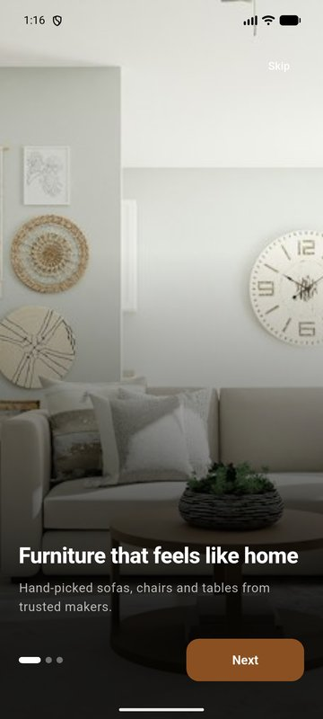
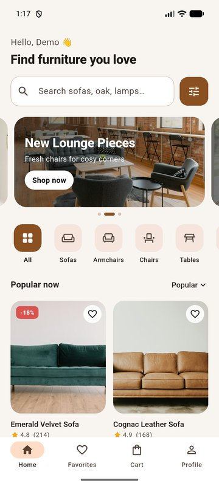
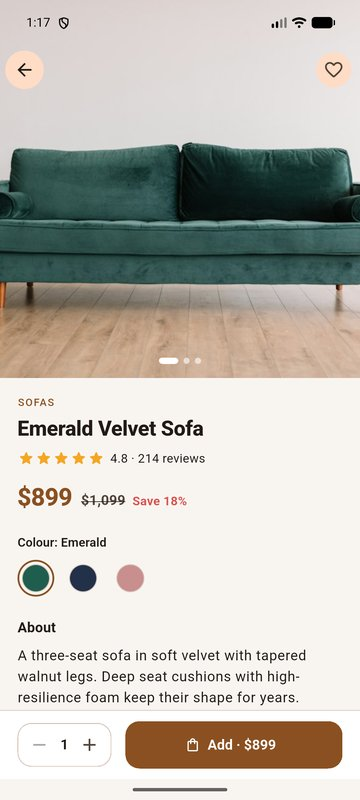
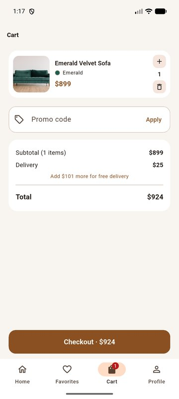

# Furniture Store

A furniture shop for Android, iOS and the web, built with Flutter and Firebase.
Its main feature: **take a photo of your room and get a matching furniture
set** — the app reads the room's style, colours and size with Google Gemini
and picks products that fit.

Languages: **Uzbek, Russian, English** (follows the phone, changeable in
Profile).

## Screenshots

| Onboarding | Home | Product | Cart |
|---|---|---|---|
|  |  |  |  |

## Features

- **AI room design**: photo → room type, style, colour palette and floor size
  (Gemini through Firebase AI Logic) → a furniture set chosen by style, colour
  harmony and what physically fits. The user can correct the room type, style
  and size; the set updates instantly. Alternatives per piece, explanations
  ("matches your Scandinavian style", "190 cm wide, 8% of the floor"), and
  "add all to cart".
- **Accounts**: email/password sign-in and registration, password reset
  (Firebase Authentication).
- **Catalog** from Cloud Firestore: search (also by category names in the
  user's language), categories, sort, filters (price, material, rating, sale).
- **Product page**: photo gallery with zoom, colours, quantity, reviews,
  related products; quick "add to cart" from the grid.
- **Cart** synced to the account: quantities (max 10 per line), promo codes
  (`SALE10`, `WELCOME20`), free delivery from $1,000.
- **Checkout**: pick the delivery point on a map (OpenStreetMap) or with the
  device location; the address is filled in automatically and the
  coordinates are stored with the order. The last address is remembered.
- **Orders**: history, status, cancel while processing.
- **Profile**: language, theme (system / light / dark), sign out.
- Floating bottom navigation with a central AI button; dark mode; loading,
  empty and error states with retry everywhere.

## Architecture

Clean Architecture, one folder per feature:

```
lib/
  main.dart, app/          bootstrap, dependency injection (get_it), router,
                           app gate, session scope, main shell + nav bar
  core/                    errors (Failure / Result / guard), Firebase helpers,
                           l10n helpers, theme, shared widgets, utils
  features/<feature>/
    domain/                entities, repository interfaces, use cases
                           (pure Dart, no Flutter or Firebase)
    data/                  data sources (Firestore, Auth, Gemini, geolocator,
                           Nominatim), models, repository implementations
    presentation/          cubits, pages, widgets, l10n labels
  l10n/                    app_{uz,ru,en}.arb + generated localizations
```

Features: `auth`, `onboarding`, `catalog`, `cart`, `favorites`, `orders`,
`location`, `room_design`, `settings`, `profile`.

Rules: presentation talks to the domain only through use cases; data sources
throw `AppException`s which repositories turn into typed `Failure`s
(`Result<T>` = `Ok` / `Err`); failures carry codes, and the UI shows the text
in the user's language. The room matcher (`RecommendFurniture`,
`ColorHarmony`, `StyleMatcher`, `FitChecker`) is pure and fully unit-tested.

## Firebase

Project: `furniture-store-bekzod` (Spark plan).

| Product | Used for |
|---|---|
| Authentication | email/password |
| Cloud Firestore | `products`, `banners` (public, read-only), `users/{uid}` (profile, address), `users/{uid}/state/{cart,favorites}`, `users/{uid}/orders` |
| AI Logic (Gemini Developer API) | room photo analysis (`gemini-3.8-flash`, falls back to `gemini-3.5-flash-lite`) |

Security rules: [`firestore.rules`](firestore.rules) (deploy with
`firebase deploy --only firestore`).

### Fill the catalog

The sample catalog is in `tool/seed/catalog.json`. To upload it to the real
project you need a service account key (Firebase console → Project settings →
Service accounts → Generate new private key; never commit it):

```bash
cd tool && npm install
GOOGLE_APPLICATION_CREDENTIALS=/path/to/key.json node seed_firestore.mjs
```

## Run

```bash
flutter pub get
flutter run
flutter test
```

### Local development with the Firebase emulators

Needs Java 21 and the Firebase CLI.

```bash
firebase emulators:start --only auth,firestore
(cd tool && FIRESTORE_EMULATOR_HOST=127.0.0.1:8080 node seed_firestore.mjs)
flutter run --dart-define=USE_EMULATOR=true                       # web, desktop
flutter run --dart-define=USE_EMULATOR=true --dart-define=EMULATOR_HOST=10.0.2.2  # Android emulator
```

On the web use a debug run (`flutter run -d chrome`). In a release web build
the Auth plugin restores a saved session before the emulator is connected,
so after a page reload sign-in calls go to the real project.

## Translations

All texts live in [`tool/l10n/strings.py`](tool/l10n/strings.py) (one row per
text: English, Uzbek, Russian). After editing:

```bash
python3 tool/l10n/strings.py   # writes lib/l10n/app_*.arb
flutter gen-l10n               # also runs on every build
```

`test/l10n/l10n_test.dart` fails if a language misses a text.

## Before publishing

- Upload the catalog to the real Firestore (see above).
- Turn on **App Check** for AI Logic and Firestore (Play Integrity / App
  Attest), otherwise anyone with the APK can use the Gemini quota.
- Release signing key for Android (`android/app/build.gradle.kts` still uses
  the debug key), app icon and splash screen.
- Product names, descriptions and banners come from Firestore in English;
  add per-language fields for full translation.
- Orders are only visible in the Firebase console; the shop needs an admin
  app or panel to process them and change their status.
- Payments are cash or card on delivery; online payment (Click, Payme) is not
  integrated.
- OpenStreetMap tiles and Nominatim geocoding are free but rate-limited;
  switch to a paid provider for many users.

## Credits

Photos: [Unsplash](https://unsplash.com). Maps: © OpenStreetMap contributors.

## Author

Bekzod Abdurahimov, Flutter developer · [GitHub](https://github.com/Bekzod123bek)
